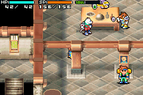

# Append-only 32 MiB EU ROM experiment

On 2026-10-05, `scripts/test_rom_expansion.py` created
`artifacts/ss2-eu-expanded-32m-ff.gba` from the verified clean EU ROM by
appending exactly 16,777,216 bytes of `0xFF`. The first 16 MiB, including all
code, pointers and the header, are byte-for-byte unchanged. No engine patch
was applied. The appended range is reserved for this empty-space experiment;
no code or tables were installed there. This does not extend the existing
same-size declarative patch builder.

`static_verified` identities:

| Input/output | SHA-256 |
| --- | --- |
| Original 16 MiB EU ROM | `e5c64a1740263e9b26120e487f3688fbbf7b3954a2c043c0d84c333df467e0b2` |
| Expanded 32 MiB EU ROM | `085009a8b4867a1533da124af43f6d69b044183d998bc1e91e3c10f82b5d632b` |
| Parent `ROMs/saves/Shining_Soul_II.sav` | `c33cc290d3c44b977b2dc84fedd31539d48d7739252f2086f9c39196b63f45b7` |

The build manifest at `artifacts/ss2-eu-expanded-32m-ff.gba.manifest.json`
also records size, MD5, CRC32, fill and allocation boundaries. Original ROM,
save, savestate and binding remained unchanged; emulator writes used isolated
copies only.

## Recorded runtime results

`runtime_verified` on the native mGBA 0.10.5 backend at revision
`26b7884bc25a5933960f3cdcd98bac1ae14d42e2`: **37 checks passed**, plus the
fresh-process reload's two checks. Full observations and assertions are in
[the evidence report](evidence/rom-expansion-32m.json); complete runs and
button transcripts are under `runs/expansion-32m-003/`.

- Both ROMs independently cold-booted the parent normal save and continued
  Paige in the inn. Recorded buttons navigated to the town shop area, moved
  left/right, walked three short loops and opened/closed the menu. Each then
  ran another 3,600 idle frames (approximately one minute of game time).
- All ten gameplay checkpoints matched exactly between the original and
  expanded ROM: screenshots, EWRAM and IWRAM hashes, PC, frame count, player
  pointer and observed actor X field. Opposite movement changed that field
  in opposite directions. No RAM/register writes were used.
- Bus reads at `0x09000000`, `0x09000100` and `0x09FFFFFC` returned
  `0xFFFFFFFF`. This confirms the appended bytes are mapped in this backend.
- A new expanded-ROM town state restored the recorded RAM, CPU and pixels.
- The ordinary game Save menu wrote an updated normal save. A separate
  Python process cold-booted the expanded ROM from that save and verified
  the original 36-byte character skill block. Its report is in
  `runs/expansion-32m-003/normal-save-reload/reload-report.json`.



## Existing savestate compatibility

The immutable old fixture was
`runs/resistance-call-explore-001/states/boot.ss1`, frame 1175, state SHA-256
`59dfdbb5ecf64f79da5d9e8c4d900633d21b81f5929a72eb4b066c03d19aa7c9`.
Its sidecar binds it to the original clean EU ROM and the same backend revision.

In the initial experiment, `runtime_verified`: the normal `Session.load_state()` rejected this old
state on the expanded ROM with `Savestate ROM SHA-256 mismatch`. This was the
harness's identity guard before the authorized exception below. The experiment validated
the original binding and file hash, copied the unchanged state into a fresh
run, and invoked the existing native loader directly. No binding was forged
and no shared guard was changed. Native mGBA accepted it, restored frame
1175, and replayed the same town route. All ten checkpoints matched the
original-ROM state replay exactly.

The pinned mGBA source in `emulator/vendor/mgba/src/gba/serialize.c` warns
on a differing whole-ROM CRC but does not make that warning fatal; game
title/ID and other state integrity checks remain active. Compatibility here
is scoped to this particular old state and native mGBA revision, not every
state or emulator.

## Harness support for the tested expansion

The user subsequently authorized accepting the expanded ROM SHA in the
harness. `Session.load_state()` now accepts original clean EU states on
**only** the exact expanded SHA-256 above, using a directional hash exception
in `emulator/__init__.py`. State-content hash, metadata format and backend
revision checks still apply. Other modded/padded ROMs and loading an
expanded-ROM state into the original ROM remain rejected. Same-ROM state
loads work as before; neither original fixtures nor sidecars need editing.

`runtime_verified`: the updated expansion script loads the old state through
the public API. Its 35 checks passed, including identical original/expanded
town replay, new-state roundtrip, ordinary Save and separate-process normal
save reload. See [harness gameplay evidence](evidence/rom-expansion-harness.json)
and `runs/expansion-32m-harness-001/`. The original 37-check report above
preserves the earlier native-only experiment.

Four focused unit tests passed for allowed and rejected hash combinations,
invalid metadata, backend mismatch, damaged state data and missing sidecars.
The [native infrastructure report](evidence/rom-expansion-harness-infrastructure.json)
also records 16 passing checks on the expanded ROM, including rejection of a
one-byte-altered ROM and corrupt/unbound states before the core is changed.

## Reproduction and manual play

From `eu/`, with a new unused output directory, reuse the exact existing
artifact without changing it:

```sh
.venv/bin/python scripts/test_rom_expansion.py --reuse-artifact \
  --output runs/expansion-new
```

To reconstruct on a clone, omit `--reuse-artifact`; the ROM and its manifest
must not already exist. Supply the private original EU ROM and parent save
first. The old state and sidecar are tracked fixtures.

For an isolated manual play session:

```sh
.venv/bin/python scripts/play.py \
  --rom artifacts/ss2-eu-expanded-32m-ff.gba \
  --save ../ROMs/saves/Shining_Soul_II.sav
```

Controls: arrows, X for A, Z for B, Enter for Start. This test build contains
no skill-refund or resistance patches.

`untested`: real hardware, other emulators, all gameplay areas, all old
savestates, and execution of injected code or use of relocated data in the
upper 16 MiB. The recorded scenarios needed no engine patch to preserve
existing gameplay, but padding alone does not implement a new feature.

Earlier runs `expansion-32m-001` and `-002` retain failed **test-route**
experiments: one reentered an inn transition and could not open Save, and one
attempted to walk right into a pillar. The corrected route and assertions
passed for both original and expanded ROMs in `-003`.
