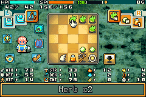
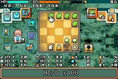

# EU inventory and consumable stacking port

Work started 2026-10-05 at the owner's request. The definition remains
`static_candidate`: named automated scenarios establish only their stated
coverage. Subsequent [owner feedback](USER_ACCEPTANCE.md#inventory--consumable-stacking--2026-10-05)
confirms that the build generally works, with one unresolved niche bug whose
trigger is still being investigated by the owner.

## Behavior and provenance

Port of `reference/upstream/patches/definitions/stackable_consumables.json`
(source definition SHA-256
`2d4549f696b57ff3ac5fc95c9808afcad114970ca871323cc0217bacc2b13253`).
All 125 source writes are checked against the exact CN 32 MiB baseline and
reconstructed before extracting the complete payload. Sparse changed chunks
are never pasted over EU data. The generator is `scripts/port_stacking.py`.

Eligible records are type 1, codes `00..06,08..13,15..1D,24,54..58`.
Stacks have a maximum of 100. Quantity zero means one existing item; it is
normalized when a stack is handled. Code 07 (Soul Return) remains excluded.
Ore (type 9) retains its category-specific field at +4, and gold (type 10)
retains its original 32-bit amount and 100,000 cap path.

## EU records and functions

The pristine EU profile SHA-256 is
`e5c64a1740263e9b26120e487f3688fbbf7b3954a2c043c0d84c333df467e0b2`.
CPU addresses below are Thumb entries unless noted. Source offsets remain
CN file offsets, never implied EU addresses.

| Role | EU CPU address / field | CN file offset |
| --- | --- | --- |
| Player pointer global | `0x030034E0` | CN global `0x03003580` |
| Inventory | player + `0x150`, 25 records, stride 16 | CN field `+0x158` |
| Item fields | type:u16 +0; code:u16 +2; quantity:u16 +4 for eligible type 1 | Same record-relative fields |
| Inventory menu pointer | `0x03006440`; selected record at dereferenced pointer +`0xF4` | CN global `0x03006500` |
| Acquire item / find bag capacity | `0x0805AB20` | `0x5B11C` |
| Copy complete record into bag slot | `0x0805CFF8` | `0x5D6AC` |
| Remove / consume inventory slot | `0x0805D580` | `0x5DC50` |
| Item valuation | `0x0805AE94`; final multiplier hook `0x0805B04A` | `0x5B4C0`, `0x5B696` |
| Remove item for menu location | `0x0807BD78` | `0x7C4DC` |
| Copy record to menu location | `0x0807BEA0` | `0x7C604` |
| Item-use removal hook | `0x0807E46A` | `0x7EC16` |
| Item-name renderer | `0x0805FFBC` | `0x606CC` |
| Quantity-aware item counter hook | `0x08061190` | `0x61910` |
| Matching bag item counter hook | `0x08080E4E` | `0x81632` |

`runs/stacking-discovery-001/fast-matches.json` records short context
candidates. The 96-byte discovery windows failed, primarily on changed
player-field constants, literal values and compiler register allocation.
Mapped functions were then inspected against instructions, branch targets,
EU globals and existing callers. Full EU instruction pre-images are declared
explicitly. Complete BL pairs are re-encoded. The generator's `HOOKS`,
`PREIMAGES`, `POINTERS` and `CALLS` tables record every correspondence.

Nine transfer branches in the inventory handler map CN `0x7CED8..0x7D5E0`
to EU `0x7C770..0x7CE78`. The menu's temporary item still occupies +`0xF4`;
its old +4 value participates in the original gold quantity selector. The
source ports eligible consumables through those quantity paths, with a
100-item limit and code equality checks before merge. The selector still
uses the original gold-style presentation (including `G`); that UI detail
is a remaining limitation.

Empty slots retain old bytes after type is cleared. Only a nonzero type
makes a record valid. Quantity conservation therefore ignores the obsolete
quantity/code of empty records.

## EU text adaptation and ABI

EU names are custom-encoded byte strings; terminal values include zero
and `0xFD`. The CN injected renderer writes halfword glyph IDs; transplanting
it would corrupt EU names. `patches/source/stacking-display.s` emits the
EU-encoded suffix ` xN` (space=0x51, x=0x38, digits=0x41..0x4A), handles 1, 9, 10, 99 and 100, and restores the original
terminal byte. LLVM MC is explicitly configured for Thumb ARM7TDMI;
there are no unresolved relocations.

EU rendering uses `r10` for its own non-consumable branches. The port
therefore reserves eight extra stack bytes by changing allocation/release
from `0x68` to `0x70`, preserving every existing local offset and stack
alignment. It captures the original item pointer at `sp+0x68`, rather than
clobbering `r10`. The suffix helper reads that word at `sp+0x70` after its
own two-register push. Its terminal instructions restore r4 and return
through r12 with r0=0, as the source helper requires. The original EU
`str r3,[sp,#0x48]` is replayed instead of CN's `#0x58`.

## Resource preservation and allocation

**Discarded:** the first 16 MiB prototype placed code in a zero run at
`0x33B80B..0x33BE6D`. The bytes are inside a declared ROM resource,
not free space. `artifacts/ss2-eu-stacking-candidate-001.gba` and its IPS
must not be used. Its original manifest and definition snapshot remain
under `runs/stacking-discovery-001/` for provenance.

The replacement explicitly expands the ROM to 32 MiB with FF fill. The
complete resource at original file `0x332170..0x33BE64` (0x9CF4 bytes,
including a 16-byte header and declared payload length 0x9CE4) is copied
unchanged to `0x1000000`. The descriptor pointer at file `0xBC448` is
changed from CPU `0x08332170` to `0x09000000`. The recipe binds both source
bytes and destination fill with SHA-256 and checks overlapping allocations.
The original resource bytes are not embedded in the recipe or BPS: a
source-copy operation preserves them directly from the user's exact ROM.

The payload owns file `0x33B80C..0x33BE20` (0x614 bytes) in the relocated
resource's former zero tail. All in-place original pre-images, the complete
payload destination, and the new resource destination are checked. New
allocation has the same modulo-four alignment as CN, preserving the
internal Thumb branches and PC-relative literal positions. Literal pools
and four external BLs are independently relocated; every inventory-base
constant changes from 0x158 to 0x150. No CN pointer remains by implication.

Classic IPS cannot distribute the expanded target. The builder now requires
BPS for that output; expansion with IPS is rejected. BPS checks source,
target and patch CRC32, and is decoded back to the exact built ROM before
publication. The manifest supplies cryptographic identities as well.
BPS encoding follows [byuu's public-domain specification](https://github.com/Sir-Walrus/Flips/blob/master/bps_spec.md).

## Test procedure and limits

`scripts/test_stacking.py` independently cold-boots each ROM from the
unchanged Paige/Priestess level-19 normal save. Each controlled case restores
its own ROM-bound state and records all RAM/register mutations and bounded
instruction stops. These are diagnostics, not naturally acquired boundary
stacks. The gameplay path uses real controls to cancel, merge two existing
Herbs, split one, merge it back, invoke the game's Save and reload in a
separate process. Fresh output paths and source hashes are required.

Shop transactions, warehouse transfers, quick-slot combat use, multiplayer,
other classes, five-language layouts, corrupt quantities and combinations
with refund/resistance/other mods require their own evidence. Do not claim
these paths passed from the source release label, boot success, isolated
valuation calls or matching record layouts. Read the recorded results below
before deciding which executable scenario should be next.

## Recorded result and reproducibility

Final experimental build: `artifacts/ss2-eu-inventory-stacking-test.gba`,
32 MiB, SHA-256
`8057383d6184597412ec33abe7d7c1c3645555e8d56bc89ee790656aef3e4cb9`.
[Build manifest](evidence/stacking-build.json),
[explicit relocations](evidence/stacking-relocations.json),
[BPS test patch](../releases/inventory-stacking-test.bps).

**320 core checks passed** in
[the A/B report](evidence/stacking-regression.json), run
`runs/stacking-regression-006/`. Acquisition covers legacy zero, 100, 101
(split to 100+1), 99+2, different codes, excluded Soul Return, ore, full-bag
atomic refusal and insufficient partial capacity. Real original slot-removal
and valuation functions cover quantities 0/1/2/100 and invalid slots 25/255.
The original-versus-patched whitelist is checked for every code 0..0x5A.
Actual inventory controls on the supplied save merge two Herbs, split one
with **Down** in the quantity selector, merge it back and cancel without
quantity loss. Both ROMs game-save and reload in independent Python
processes; the valid stack and full recorded bag bytes agree exactly.
All source ROM/save inputs remained unchanged.

**125 display checks passed** in
[the five-language report](evidence/stacking-display.json), run
`runs/stacking-display-001/`. Thirty disclosed synthetic quantity cases
(0/1/9/10/99/100 × five languages) exercise the actual item renderer through
button-triggered name refresh. They verify exact glyph suffix bytes, terminal
preservation, stack restoration and return value. Screenshots were generated;
English x2 after normal-save reload and x100 were visually checked.





The infrastructure suite now has **42 passing tests**, including expansion
limits, full pre-image refusal, copy source/destination hash/range/overlap
checks, IPS refusal, BPS standard integer vectors, all action kinds,
checksum/bounds/truncation refusal and relocation without literal ROM data.

Early runs diagnosed test-driver issues: a one-frame key after a mid-frame
instruction stop could be dropped; the driver now resumes two frames first.
The game unloads the live player after Save, so persistence expectations are
captured before Save rather than reading cleared RAM afterward. Down, not
Left, changes the quantity by one. These corrections did not change ROM
bytes. Visual QA then found ASCII assumptions in the suffix; the final
003 build uses the verified EU glyph codes. Builds 001 and 002 are superseded.

Use new paths from `eu/`:

```sh
.venv/bin/python scripts/port_stacking.py --output artifacts/stacking-new-definition.json
python -m ss2tools build inputs/ss2-eu.gba patches/stackable-consumables.json \
  artifacts/stacking-new.gba --profile profiles/ss2-eu.json \
  --bps artifacts/stacking-new.bps --allow-static-candidate
.venv/bin/python scripts/test_stacking.py --patched artifacts/stacking-new.gba \
  --output runs/stacking-new
.venv/bin/python scripts/test_stacking_display.py --patched artifacts/stacking-new.gba \
  --output runs/stacking-display-new
```

Resource consumer audit remains open: the descriptor/header/payload extent
and absence of direct pointers into the overwritten zero prefix are verified;
a full instruction-level audit of the descriptor reader has not been
completed. Other direct references into the original resource retain their
original unchanged bytes outside the overwritten prefix. Moving the
complete descriptor resource preserves relative addressing within it, but
this is not a universal resource regression claim.
